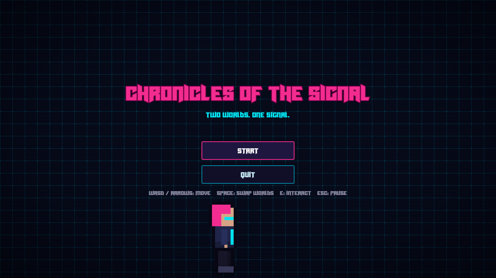
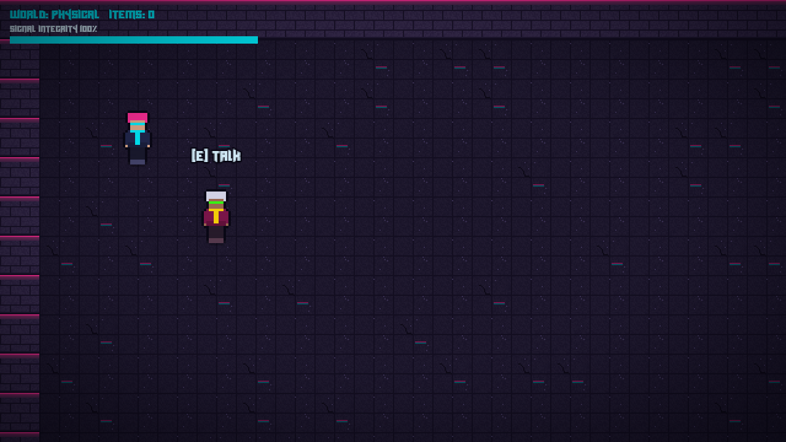
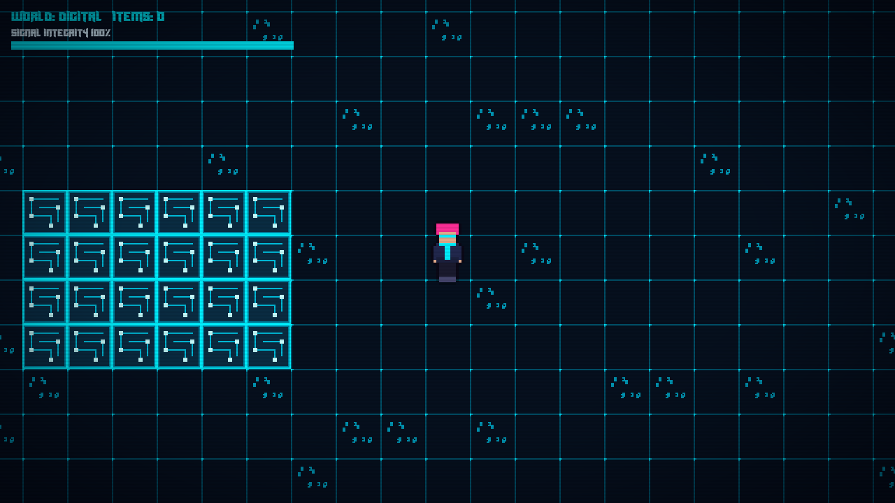
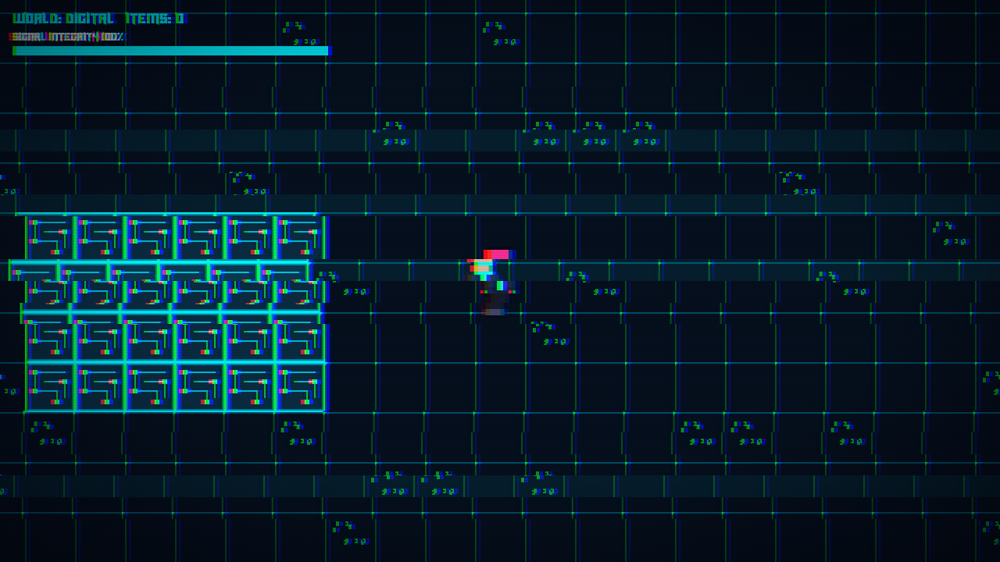
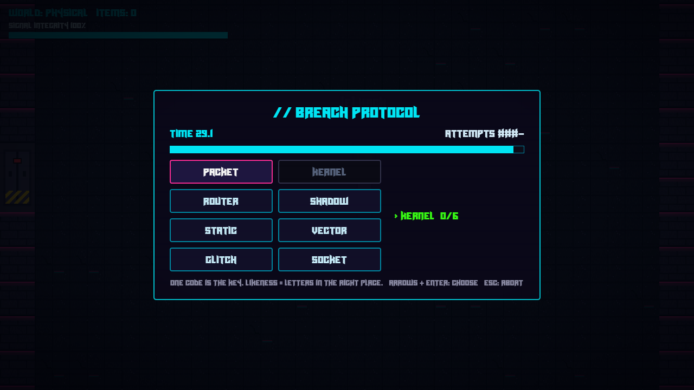

# Chronicles of the Signal (In progress building)

A cyberpunk dual-reality adventure built with **Godot 4** and **GDScript**. The classic **2D** version is live in the browser (HTML5/WebAssembly); a **3D open-world action-adventure** version is in development on the `3d-prototype` branch, targeting Windows.

> Explore a neon-soaked city that exists in two overlapping realities — the **Physical World** and the **Digital Memory Grid** — switching between them on the fly to solve puzzles, evade threats, and uncover the signal hidden beneath the city.

> The original Python / Arcade prototype is preserved at the git tag `python-arcade-prototype`.

## 🧰 Tech Stack

<div align="left">
  <a href="https://godotengine.org/"></a>
  <a href="https://docs.godotengine.org/en/stable/tutorials/scripting/gdscript/gdscript_basics.html"></a>
  <a href="https://itch.io/"></a>
  <a href="https://github.com/"></a>
</div>

---

## 🖼 Preview

<p align="center">
  
</p>

<table>
  <tr>
    <td align="center"><br /><sub><b>Physical World</b> &mdash; neon-lit brick and asphalt</sub></td>
    <td align="center"><br /><sub><b>Digital Memory Grid</b> &mdash; the same room, different rules</sub></td>
  </tr>
  <tr>
    <td align="center"><br /><sub>Pressing <b>Space</b> glitches reality between the two worlds</sub></td>
    <td align="center"><br /><sub>Timed code-breaker minigame</sub></td>
  </tr>
</table>

> Art and audio are placeholders, generated for prototyping. The screenshots were taken in the early test room; the game now has two full districts.

---

## 🎮 What's in the game

Two playable districts and a short story with two endings:

- **District 01 &mdash; Static Row:** learn the world swap, hacking, levers, doors and a timed gate.
- **District 02 &mdash; The Archive:** alternating one-world walls, a three-key gate, a timed gate with a risky shortcut, and the Curator's core.
- **Trace drones** patrol the Digital world and drain signal integrity. Swapping back is the escape.
- **Hint system:** press **H** for a hint on the next unsolved puzzle. Each press is more specific.
- **Story fragments**, NPC dialogue with choices, and an ending choice (restore the city's memories or keep your own).
- **Checkpoints**, autosave and a **Continue** button on the title screen.
- **Audio:** sound effects, a music loop per world, and volume sliders in the pause menu.
- **Controller support** (untested on a real pad). See [md file/STORY.md](md%20file/STORY.md) for the story and design notes.

## 🧊 3D Prototype (branch `3d-prototype`, Windows)

The 2D game is being rebuilt as a 3D open-world action-adventure. The web build stays 2D; the title screen's **Start 3D (new)** button is hidden on web.

- **Look:** a low fixed-angle camera behind the player, rendered into a 480x270 `SubViewport` and upscaled with nearest filtering for a pixel-art feel. Billboard sprite characters, wet neon streets, rain, and walls that cut away when they block the view.
- **Two worlds, same rules:** Space swaps Physical and Digital. Walls, enemies and even enemy bolts exist in only one world.
- **Combat:** **J** melee strike and **K** hack pulse (ranged). Enemies: Trace drones, Enforcers, Stalkers (Digital, pass through walls), Sentries (Physical turrets that fire bolts).
- **Boss:** the Curator in the Relay Tower. It flips worlds on a timed telegraph, is armoured in its Physical form (pulse only), and escalates in three phases. Beating it triggers the ending choice.
- **Open world:** Vantage Plaza hub plus four districts (Static Row, The Archive, Neon Market, Relay Tower), beacons for checkpoints and fast travel (**T**), and a minimap.
- **Adventure systems:** quests with a HUD tracker and a journal (**Tab**), optional side quests, collectible memory fragments and data nodes, a hidden cache, and upgrades (Pulse Core, Strike Edge, Hardened Plating, Signal Cell, Phase Boots, Echo Core).
- **Saves:** autosave on entering a district, a SAVED indicator, a **Continue (3D)** button, and a fallback for a corrupt save file.
- **Polish so far:** doorway names are full-resolution HUD labels, extra sound effects for bolts and the boss, and controller bindings for every 3D action.

**3D controls:** WASD move, **Space** swap, **E** interact, **J** strike, **K** pulse, **T** fast travel, **Tab** journal, **H** hint.
**3D controller:** stick/D-pad move, **A** interact, **B** strike, **Right shoulder** pulse, **Y** swap, **X** hint, **Left shoulder** fast travel, **Back** journal.

3D code lives in `scripts3d/`, `scenes3d/`, `shaders3d/`, `assets3d/` and `data3d/` (quests). It shares the autoloads with the 2D game, and 3D district ids are prefixed `3d_` so saves never clash.

Dev checks (headless Godot scripts in `tools/`, each using a throwaway save file):

```
godot --headless --path . --script res://tools/test_content_3d.gd -- <out_dir>
```

Suites: `test_world_3d`, `test_adventure_3d`, `test_content_3d`, `test_title_3d`; `test_combat_3d` needs a real window (no `--headless`). Sprites are generated with `tools/make_assets_3d.py` and extra sounds with `tools/make_sfx_3d.py`.

## 📖 Overview

**Chronicles of the Signal** is a narrative-driven, tile-based RPG centered around **Dual-Layer Exploration**: at any moment, the player can hit **Space** to phase between the tangible, physical city and its digital "memory grid" counterpart. Each world has its own collision geometry, visuals, NPCs, and soundscape, enabling puzzles that depend on perceiving both sides of reality.

Architecture:

- **`GameState` autoload** — health, signal integrity, inventory, hacked terminals and story flags persist across scenes.
- **`WorldLayers`** — each world is a `TileMapLayer`; toggling `enabled` swaps drawing *and* collision at once. A swap is blocked if it would leave the player inside a wall.
- **Interactables** — everything the player can press **E** on extends `Interactable` (an `Area2D`). Set its `realm` to make it exist in only one world. Terminals, doors, NPCs and pickups are built on it.
- **Autoloads** — `GameState` (persistent state, save/load, checkpoints), `SceneManager` (fade scene changes), `Audio` (sound effects, music, volume), `Dialogue` (typewriter dialogue box and `Dialogue.ask()` choices).
- **Districts** — every district scene extends `District` (`scenes/world/district.gd`), which provides the HUD, hints, music, checkpoints and the signal-lost reboot. A district only supplies its map, objects and hint list.
- **Text maps** — each district's layout is a text file in `scenes/world/maps/` (`#` wall in both worlds, `.` floor, `P` wall in Physical only, `D` wall in Digital only).
- **Puzzles** — `Terminal` (hack), `Switch` (lever, optionally timed), `Door` (needs one or more keys, never closes on the player) and `Drone` (Digital-world hazard).
- **Hacking** — `HackMinigame` is a timed code-breaker: find the key among 8 codes using the "likeness" hint before attempts or time run out. Failing costs signal integrity; reaching 0 reboots the level.
- **Placeholder art and audio** — sprites, tiles and sounds in `assets/` are generated (`tools/make_assets.py`) and follow fixed layouts and file names (see `character_sprite.gd`), so real art and audio can be dropped in over the same files.
- **Signals over references** — systems talk through signals such as `layer_changed`.

## 📁 Project Structure

```
chronicles_of_the_signal/
├── project.godot            # Engine config, input actions, physics layer names
├── scenes/
│   ├── player/              # player.tscn + player.gd
│   ├── interactables/       # interactable.gd base + terminal, switch, door, npc, pickup, checkpoint, exit zone
│   ├── hazards/             # drone (Digital-world threat)
│   └── world/               # district.gd base, district_01/02 scenes, world_layers.gd, maps/*.txt
├── scripts/autoload/        # game_state.gd, scene_manager.gd, audio.gd
├── ui/                      # title, end screen, pause menu, dialogue box, hacking minigame, theme
├── fx/ + shaders/           # screen effects: glitch pulse, scanlines, vignette
├── scripts3d/ scenes3d/     # 3D prototype: districts, player, enemies, boss, quests, UI
├── shaders3d/ assets3d/     # 3D shaders and generated sprites
├── data3d/                  # quests.json
├── tools/                   # make_assets*.py, make_sfx_3d.py, 3D tests and capture scripts
├── md file/                 # STORY.md, TODO.md, DONE_1.md (design and progress notes)
└── assets/                  # fonts/, tiles/, sprites/, sounds/ (placeholder art and audio)
```

## 🚀 Getting Started

1. Install **Godot 4.3 or newer** (standard build — *not* .NET; C# cannot export to web).
2. Open Godot → **Import** → select `project.godot`.
3. Press **F5** to run.

**Controls:** WASD / arrows to move, **Space** to swap worlds, **E** interact, **H** hint, **Esc** pause.

**Controller:** D-pad or left stick to move, **A** interact, **X** hint, **Y** swap worlds, **Start** pause.

To regenerate the placeholder art and audio: `pip install pillow numpy`, then `python tools/make_assets.py`.

### Physics layers

| # | Name | Used by |
|---|---|---|
| 1 | `player` | Player body |
| 2 | `world_physical` | Physical-world walls |
| 3 | `world_digital` | Digital-world walls |
| 4 | `interactable` | Terminals, doors, NPCs |

## 🌐 Web Export

1. **Project → Export → Web**, and install the export templates when prompted.
2. Click **Export Project** — the preset writes to `web/index.html` (keep the file name `index.html`).
3. Commit the `web/` folder and push to `main`. Netlify serves `web/` automatically (see `netlify.toml`) at https://chronicles-of-signal.netlify.app.
4. For itch.io, zip the contents of `web/` and upload it as an HTML5 game.

`web/.gdignore` stops Godot from importing the exported files back into the project.

Browsers block audio until the first click or key press, so keep a title screen before gameplay.

## 🗺 Roadmap

- [x] Port project to Godot, global state, layer swap trial
- [x] Interactables, NPC dialogue, title screen, pause menu
- [x] Terminal hacking minigame (timed code-breaker)
- [x] Glitch shader, animated character, UI theme
- [x] District 01 and District 02 with puzzles, drones, checkpoints and two endings
- [x] Hint system, dialogue choices, audio, volume settings, save/load
- [x] 3D prototype: camera, two-world swap, combat, hub and districts (3d-prototype branch)
- [x] 3D adventure systems: quests, journal, upgrades, boss fight, saves
- [ ] 3D art, lighting and props pass; sound polish
- [ ] Windows export, performance pass and itch.io page for the 3D version
- [ ] Playtesting and balance
- [ ] Real art, tiles and audio (replace the placeholders)
- [ ] Key rebinding and a tested controller setup
- [ ] Web export check in Chrome and Firefox
- [ ] itch.io release

## 🔗 Useful Links

- Godot docs: https://docs.godotengine.org/
- itch.io HTML5 guide: https://itch.io/docs/creators/html5

## 📄 License

This project is licensed under the MIT License — feel free to fork, modify, and build your own signal.
