# Chronicles of the Signal (In progress building)

A cyberpunk dual-reality **3D action-adventure** built with **Godot 4** and **GDScript**, for Windows.

> Explore a neon-soaked city that exists in two overlapping realities, the **Physical World** and the **Digital Memory Grid**. Swap between them on the fly to solve puzzles, fight machines, face the Curator and uncover the signal hidden beneath the city.

## 🧰 Tech Stack

<div align="left">
  <a href="https://godotengine.org/"></a>
  <a href="https://docs.godotengine.org/en/stable/tutorials/scripting/gdscript/gdscript_basics.html"></a>
  <a href="https://itch.io/"></a>
  <a href="https://github.com/"></a>
</div>

---

## 🖼 Preview

<p align="center">
  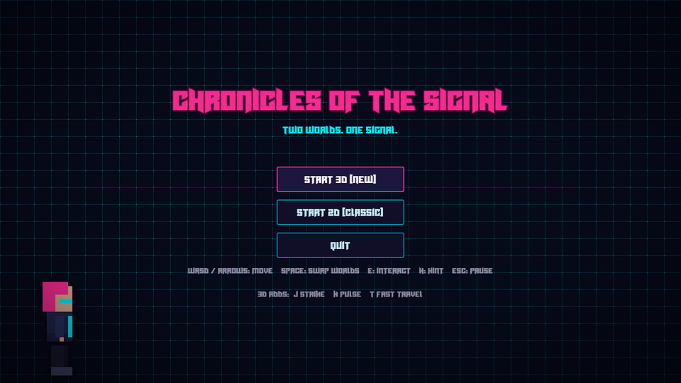
</p>

<table>
  <tr>
    <td align="center">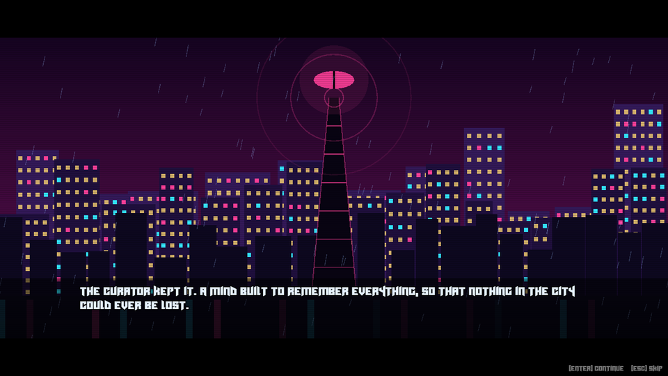<br /><sub><b>Intro</b> &mdash; the Curator kept the Signal</sub></td>
    <td align="center">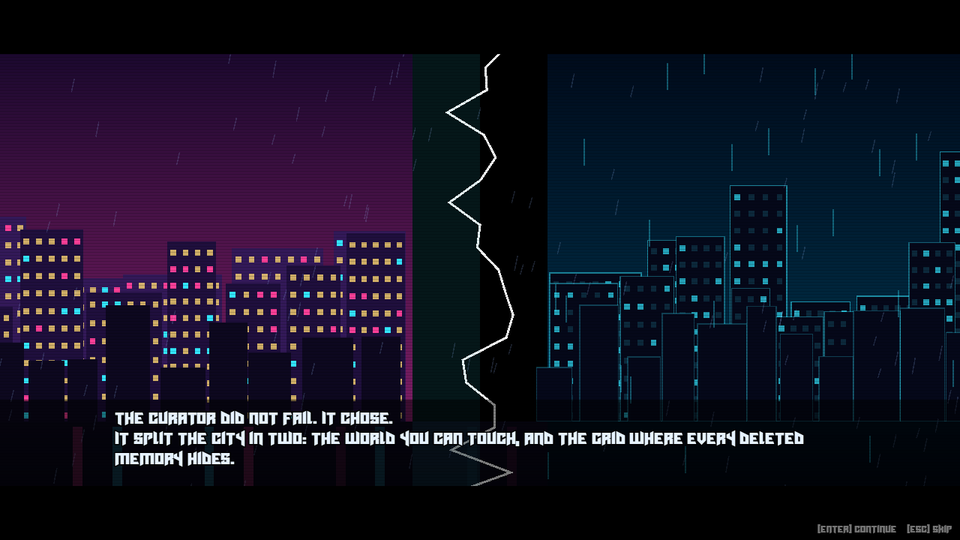<br /><sub><b>Intro</b> &mdash; the city splits into Physical and Grid</sub></td>
  </tr>
  <tr>
    <td align="center">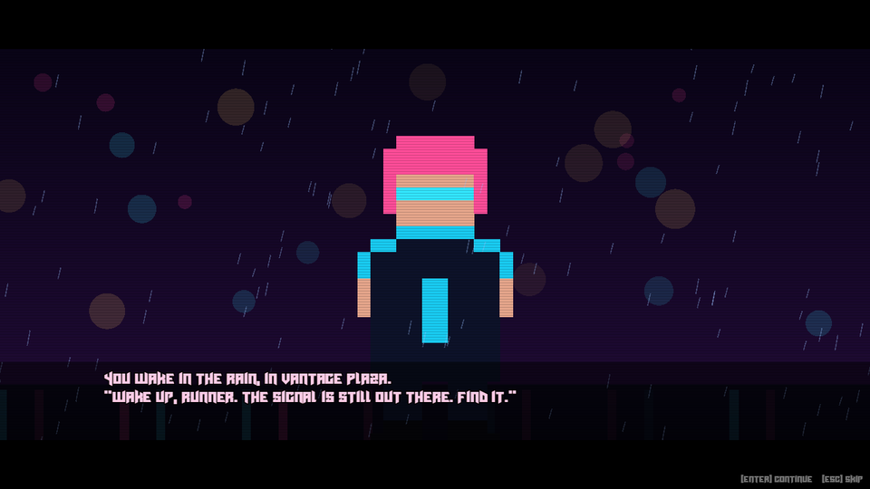<br /><sub><b>Intro</b> &mdash; "Wake up, Runner."</sub></td>
    <td align="center">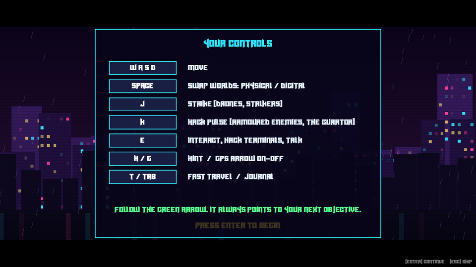<br /><sub><b>Intro</b> &mdash; ends on the controls card</sub></td>
  </tr>
  <tr>
    <td align="center">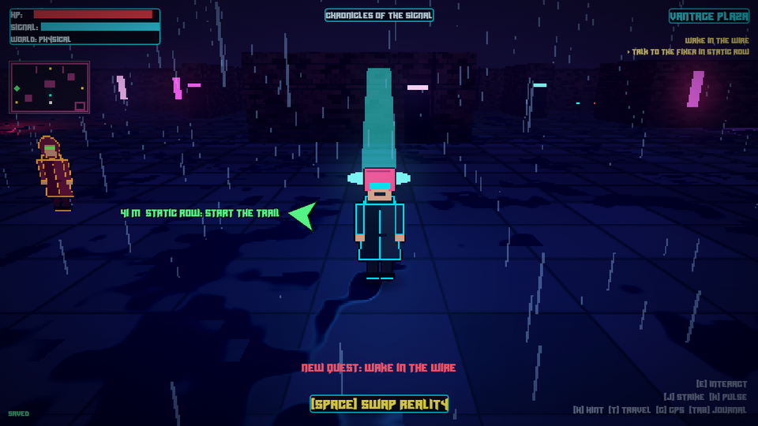<br /><sub><b>GPS</b> &mdash; a green arrow points to your next objective</sub></td>
    <td align="center">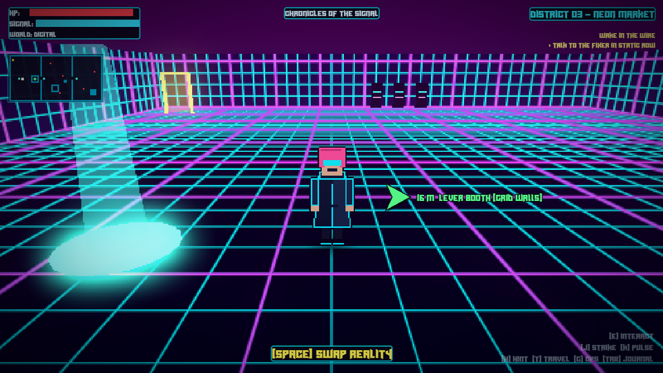<br /><sub><b>The Grid</b> &mdash; Neon Market, with the goal on the minimap</sub></td>
  </tr>
  <tr>
    <td align="center">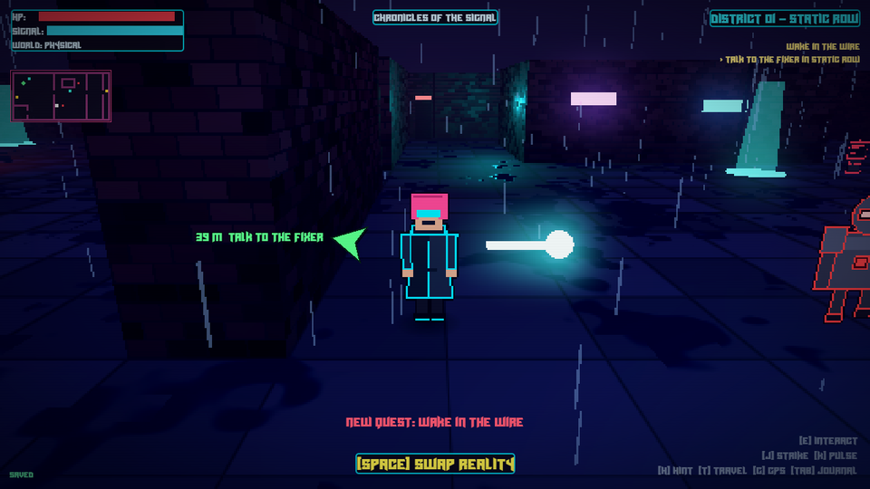<br /><sub><b>Combat</b> &mdash; the K pulse against an armoured Enforcer</sub></td>
    <td align="center">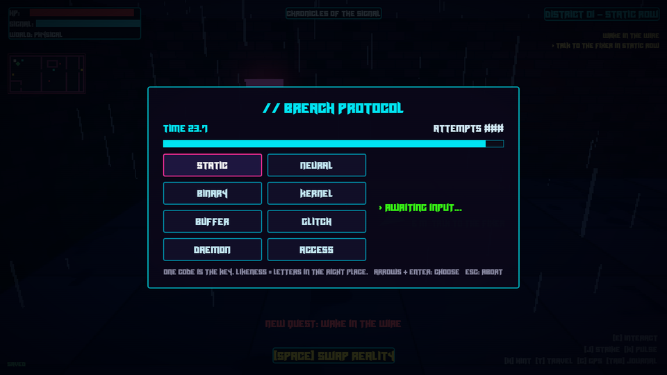<br /><sub><b>Hacking</b> &mdash; a timed code-breaker minigame</sub></td>
  </tr>
  <tr>
    <td align="center">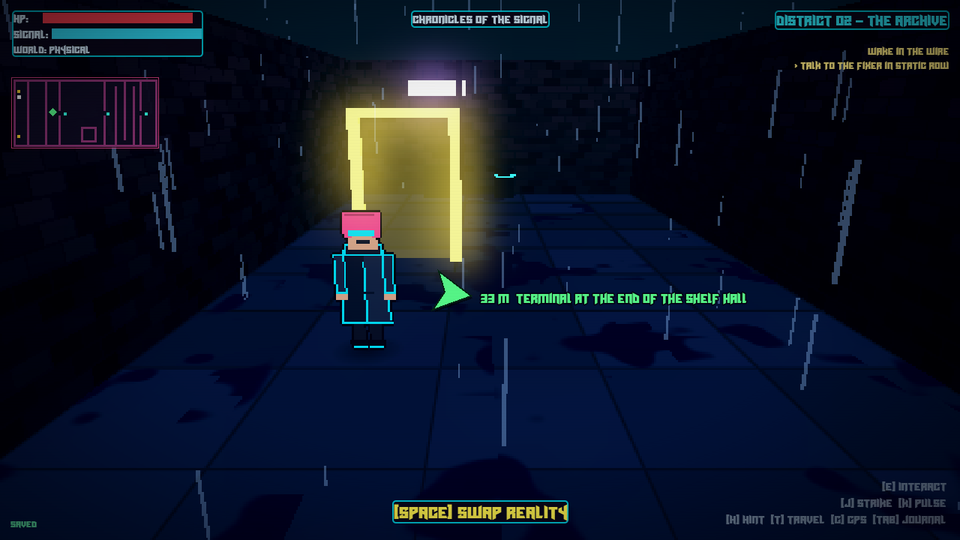<br /><sub><b>Per-district lighting</b> &mdash; the Archive's cold teal</sub></td>
    <td align="center">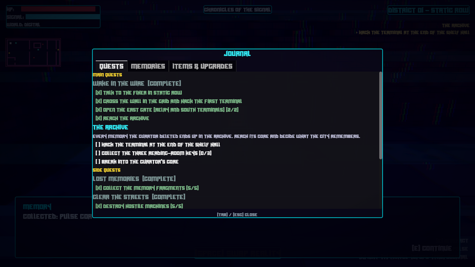<br /><sub><b>Journal</b> &mdash; quests, memories, items and upgrades</sub></td>
  </tr>
  <tr>
    <td align="center">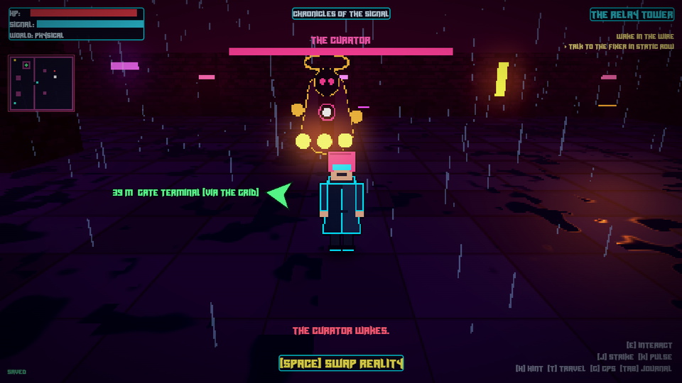<br /><sub><b>Boss</b> &mdash; the Curator, Physical form (armoured)</sub></td>
    <td align="center">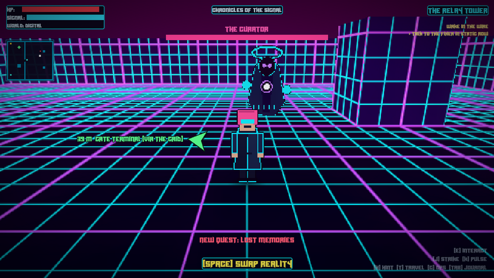<br /><sub><b>Boss</b> &mdash; Digital form, after it flips worlds</sub></td>
  </tr>
</table>

> Art and audio are placeholders, generated for prototyping.

---

## 🎮 What's in the game

- **Story and onboarding:** an animated, narrated intro drawn in code (the rainy skyline and the Signal tower with the Curator's eye, the blackout, the city splitting into the real world and the Grid, the Runner waking in Vantage Plaza) that ends on a controls card. **Enter** or click advances (the first press finishes the typed line), **Esc** skips to the controls card.
- **GPS:** a green arrow orbits the player and points at the next objective, with the distance and a short label (for example `41 m  Static Row: start the trail`). The goal also shows on the minimap. It follows your story progress in every district, hides when you arrive and during dialogue, and **G** toggles it.
- **Two worlds, same rules:** **Space** swaps Physical and Digital. Walls, enemies and even enemy bolts exist in only one world, and a swap is blocked if it would leave you inside a wall.
- **Combat:** **J** melee strike and **K** hack pulse (ranged). Trace drones, Enforcers (armoured, pulse only), Stalkers (Grid only, walk through walls) and Sentries (Physical turrets that fire bolts).
- **Boss:** the Curator in the Relay Tower. It flips worlds on a timed telegraph, is armoured in its Physical form, summons Stalkers and Enforcers, and escalates in three phases. Beating it triggers the **Restore / Keep** ending choice.
- **Open world:** the Vantage Plaza hub plus four districts (Static Row, The Archive, Neon Market, Relay Tower), beacons for checkpoints and fast travel (**T**), and a minimap.
- **Puzzles:** terminals with a timed code-breaker hacking minigame, levers (some timed), multi-key doors, and walls that exist in only one world. **H** gives progressively more specific hints.
- **Adventure systems:** quests with a HUD tracker and a journal (**Tab**), optional side quests, collectible memory fragments and data nodes, a hidden cache, and upgrades (Pulse Core, Strike Edge, Hardened Plating, Signal Cell, Phase Boots, Echo Core).
- **Look:** a low fixed-angle camera behind the player, rendered into a 480x270 `SubViewport` and upscaled with nearest filtering for a pixel-art feel. Billboard sprite characters, wet neon streets, rain, walls that cut away when they block the view, a lighting palette per district, flickering lamps and set-dressing props.
- **Saves:** autosave on entering a district, a SAVED indicator, a **Continue** button, and a fallback for a corrupt save file.
- **Audio:** sound effects, a music loop per world, and volume sliders in the pause menu.

See [md file/STORY.md](md%20file/STORY.md) for the original story and design notes.

## 🕹 Controls

| Action | Keyboard | Controller |
|---|---|---|
| Move | WASD / arrows | Left stick / D-pad |
| Swap worlds | Space | Y |
| Interact / hack | E | A |
| Strike | J or left click | B |
| Hack pulse | K or right click | Right shoulder |
| Hint | H | X |
| GPS on / off | G | Right stick click |
| Fast travel | T | Left shoulder |
| Journal | Tab | Back |
| Pause | Esc | Start |

Controller support is untested on a real pad.

## 📖 Overview

**Chronicles of the Signal** is a narrative-driven adventure centered around **Dual-Layer Exploration**: at any moment the player can hit **Space** to phase between the tangible, physical city and its digital "memory grid" counterpart. Each world has its own collision geometry, visuals, enemies and soundscape, enabling puzzles and fights that depend on perceiving both sides of reality.

Architecture:

- **Autoloads:** `GameState` (health, signal integrity, inventory, hacked terminals, story flags, save/load, checkpoints), `SceneManager` (fade scene changes), `Audio` (sound effects, music, volume) and `Dialogue` (typewriter dialogue box and `Dialogue.ask()` choices).
- **`District3D`** (`scripts3d/district_3d.gd`) is the base of every district: it builds the pixel viewport, HUD, minimap, GPS, journal, lighting, props and autosave. A district overrides `_populate()`, `_objectives()` (hints), `_gps_target()` and optionally `_theme()` (its colours).
- **Text maps:** each district's layout is a text file in `scenes3d/maps/` (`#` wall in both worlds, `.` floor, `P` wall in Physical only, `D` wall in Digital only). **`WorldLayers3D`** turns it into two 3D worlds with their own collision and hides the walls that block the camera.
- **Interactables:** everything the player can press **E** on extends `Interactable3D` (an `Area3D`); set its `realm` to make it exist in only one world. Terminals, doors, levers, NPCs, pickups, beacons and exits are built on it.
- **`Enemy3D`** is the enemy base with hooks (which world it lives in, what hurts it, contact damage); drones, Enforcers, Stalkers, Sentries and the Curator extend it. Enemy bolts only exist in the world they were fired in.
- **`Quests3D`** reads `data3d/quests.json` and keeps its state in `GameState.flags`, so quests and upgrades are saved with everything else.
- **Hacking:** `HackMinigame` is a timed code-breaker: find the key among 8 codes using the "likeness" hint before attempts or time run out. Failing costs signal integrity; reaching 0 reboots the level.
- **`Intro3D`** is the opening cinematic; **`Gps3D`** draws the objective arrow.
- **Placeholder art and audio:** sprites are generated by `tools/make_assets_3d.py`, sounds by `tools/make_audio.py` and `tools/make_sfx_3d.py`, and follow fixed file names so real art and audio can be dropped in over the same files.

## 📁 Project Structure

```
chronicles_of_the_signal/
├── project.godot            # Engine config, input actions, physics layer names
├── icon.png / icon.ico      # App icon (generated by tools/make_icon.py)
├── scripts/autoload/        # game_state.gd, scene_manager.gd, audio.gd
├── scripts3d/               # districts, player, camera, enemies, boss, quests, GPS, intro, UI panels
├── scenes3d/                # district scenes, the intro, and maps/*.txt
├── shaders3d/ assets3d/     # 3D shaders and generated sprites
├── data3d/                  # quests.json
├── ui/                      # title, end screen, pause menu, dialogue box, hacking minigame, theme
├── fx/ + shaders/           # screen effects: glitch pulse, scanlines, vignette
├── assets/                  # fonts/ and sounds/ (placeholder audio)
├── tools/                   # asset generators, tests, screenshot captures, Windows build script
├── docs/                    # screenshots/, ITCH_PAGE.md, RELEASE_CHECKLIST.md
└── md file/                 # STORY.md and early design notes
```

## 🚀 Getting Started

1. Install **Godot 4.7** (standard build, *not* .NET).
2. Open Godot → **Import** → select `project.godot`.
3. Press **F5** to run.

To regenerate the placeholder assets: `pip install pillow numpy`, then `python tools/make_assets_3d.py` (sprites), `python tools/make_audio.py` and `python tools/make_sfx_3d.py` (sound), and `python tools/make_icon.py` (icon).

### Physics layers

| # | Name | Used by |
|---|---|---|
| 1 | `player` | Player body |
| 2 | `world_physical` | Physical-world walls |
| 3 | `world_digital` | Digital-world walls |
| 4 | `interactable` | Terminals, doors, NPCs |

## 🪟 Windows Build

The game ships as a single Windows `.exe` (the game is embedded in it).

1. Install the Windows export templates once: **Editor → Manage Export Templates → Download and Install** (they must match the editor version).
2. Run `powershell -File tools/build_windows.ps1`. It exports the `Windows Desktop` preset and writes `build/ChroniclesOfTheSignal-windows.zip` (git-ignored).
3. Run `powershell -File tools/smoke_exe.ps1` to check every scene loads from the packed `.exe`.
4. Follow [docs/RELEASE_CHECKLIST.md](docs/RELEASE_CHECKLIST.md) to smoke-test the `.exe` on a machine without Godot, then use [docs/ITCH_PAGE.md](docs/ITCH_PAGE.md) to set up the itch.io page.

**Renderer:** the Compatibility (OpenGL) renderer. Forward+ measured faster (3 to 4 ms against 5 to 7 ms per frame on an Intel Iris Xe at 1280x720) but is not needed and requires a working Vulkan driver, so Compatibility stays the default. To try Forward+: `godot --path . --rendering-method forward_plus --rendering-driver vulkan`.

## 🧪 Dev checks

Godot scripts in `tools/`; each one uses a throwaway save file:

```
godot --headless --path . --script res://tools/test_content_3d.gd -- <out_dir>
```

- Headless: `test_title_3d`, `test_reach_3d` (an automated playtest: flood-fills each map with the real swap rules and checks every terminal, pickup, NPC, beacon and exit can be reached).
- Need a real window (leave out `--headless`; they read the rendered frame): `test_world_3d`, `test_adventure_3d`, `test_content_3d`, `test_combat_3d`, `test_gps_3d`.
- Performance: `perf_3d` prints average and worst frame time, draw calls and objects for every district (vsync off). On an Intel Iris Xe at 1280x720 every district runs at 140 to 200 fps.
- Screenshot tools: `capture_title_3d`, `capture_intro_3d`, `capture_polish_3d`, `capture_boss_3d`, `capture_combat_3d`, `capture_hack_3d`. The images in `docs/screenshots/` came from these.
- Any run started with `--script` defaults to a throwaway save file (`user://dev_test_save.json`), so tests and captures can never overwrite a real save.

## 🗺 Roadmap

- [x] Camera, two-world swap, combat, hub and districts
- [x] Quests, journal, upgrades, the Curator boss and two endings
- [x] Intro cinematic and in-game GPS
- [x] Lighting palettes, props, readable exit labels and boss sounds
- [x] Windows export preset, build script, performance pass and automated reachability playtest
- [x] itch.io page text and release checklist ([docs/](docs/))
- [x] Windows `.exe` builds (single file, 37 MB zipped) and every scene loads from the packed build
- [ ] Hand playtest the `.exe` and publish the itch.io page
- [ ] Playtesting and balance
- [ ] Real art (the sprites are generated placeholders) and a listening pass on the new sounds
- [ ] Key rebinding and a tested controller setup

## 🔗 Useful Links

- Godot docs: https://docs.godotengine.org/
- itch.io creator docs: https://itch.io/docs/creators/

## 📄 License

This project is licensed under the MIT License. Feel free to fork, modify, and build your own signal.
