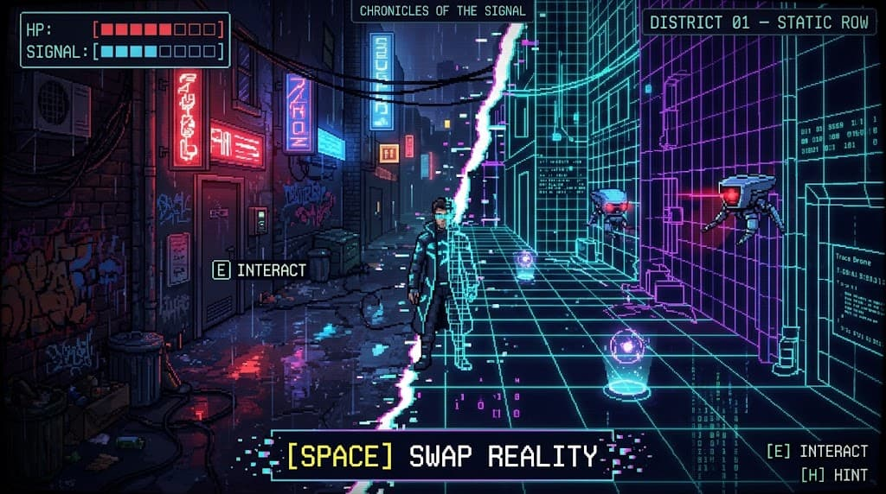

# 3D Transition Plan: Chronicles of the Signal

Plan for moving the game from top-down 2D to a 3D version that keeps the same art direction and theme.

Reference image: 

Legend: `[ ]` not started, `[~]` partly done, `[x]` done.

---

## 1. Target look (from the reference image)

- A 3D alley rendered in a chunky **pixel-art style**.
- **Physical world:** rain, neon signs, wet reflective floor, graffiti, bins, cables, dark brick.
- **Digital world:** glowing cyan/magenta wireframe grid, data text, hologram orbs.
- A **jagged diagonal glitch line** splits the two worlds during the swap (`[SPACE] SWAP REALITY`).
- Player and drones are **billboard pixel sprites** in the 3D space.
- HUD: HP and SIGNAL bars (top left), district name (top right), `[E] INTERACT` and `[H] HINT` prompts, game title banner (top centre).

## 2. Where the project is today

- Godot 4.7, GL Compatibility renderer, 2D top-down.
- Player: `CharacterBody2D` ([player.gd](../scenes/player/player.gd)).
- Levels: text maps (`scenes/world/maps/*.txt`) built into `TileMapLayer`s by [world_layers.gd](../scenes/world/world_layers.gd).
- Swap: each world is a layer; disabling a layer removes its visuals and collision (physics layers 2 `world_physical`, 3 `world_digital`).
- Districts share logic in [district.gd](../scenes/world/district.gd) (HUD, hints, checkpoints, signal-lost reboot).

## 3. What carries over unchanged

- `GameState`, `SceneManager`, `Audio` autoloads
- Dialogue box, hint system (H), pause menu, end screen, title screen
- Hack minigame (stays a 2D UI overlay)
- Story, district list, puzzle design (see [STORY.md](STORY.md))
- CRT and glitch shaders (with minor tuning)
- Input actions (`move_*`, `interact`, `hint`, `toggle_layer`)

## 4. What must be rewritten for 3D

| Area | 2D today | 3D target |
|---|---|---|
| Player | `CharacterBody2D`, 300 px/s | `CharacterBody3D`, follow camera, billboard sprite |
| World | `TileMapLayer` from `.txt` map | Generated 3D geometry (floor, walls, props) from the same `.txt` maps |
| Layer swap | Toggle `TileMapLayer.enabled` | Two world roots (Physical, Digital); toggle visibility and collision layers |
| Interactables | `Area2D`-based scenes | `Area3D`-based scenes, same logic scripts |
| Hazards | 2D drones | 3D drones (billboard sprite plus 3D movement and detection) |
| Camera | 2D camera with limits | `Camera3D` follow rig (fixed angle) with bounds from the map size |
| District base | `District extends Node2D` | `District3D extends Node3D`, reusing hints, notices and reboot logic |

## 5. What must be added

- **Physical-world art:** neon sign meshes/emissive quads, rain particles, wet-floor reflection, props (bins, pipes, doors, graffiti decals).
- **Digital-world art:** emissive wireframe grid shader, data-text decals, hologram orb pickups.
- **Pixel-art rendering:** render the 3D scene to a low-resolution `SubViewport` (for example 480x270) and upscale with nearest-neighbour filtering. Keep the UI at full resolution on top.
- **Glitch-line swap transition:** a screen-space shader that wipes Physical to Digital along a jagged diagonal.
- **Lighting and post:** glow/bloom, fog, coloured lights per world, stronger CRT overlay.
- **Sprites:** 4-direction character and drone sprites usable as billboards (existing sprites in `assets/sprites` can be reused).
- **Map-to-3D generator:** a tool or script that reads `.txt` maps and spawns the walls, floors and the P/D-only blocks.

## 6. Decisions needed

- [x] **Replace 2D or build alongside?** Decided: alongside, in separate folders (`scenes3d/`, `scripts3d/`), sharing `GameState`. The working 2D game stays safe and doubles as the web demo.
- [x] **Platform / web export?** Decided: native **Windows desktop** is the main target, with the **Forward+** renderer. Web is optional later (see section 6a).
- [ ] **Camera style:** fixed angled camera (like the reference), or a free third-person camera?
- [ ] **Movement:** keep 4/8-direction movement on the ground plane, or add free rotation?

## 6a. Platform and distribution (recommended)

**Main target: native Windows build, Forward+ renderer.**

- Forward+ gives the glow, reflections, fog and volumetric lighting the reference image needs. Web export forces GL Compatibility, which has weak or no support for these.
- Better and more predictable performance than a browser; no WebGL or Chrome/Firefox shader differences to debug.
- Godot 3D web builds are large and slow to load.

**Distribution**
- **itch.io:** reuse the existing private draft page; upload a Windows zip instead of the web build.
- **Steam:** possible later if the game grows.
- **Linux / macOS:** easy to add later from the same project.

**Web (optional, later)**
- Keep the existing 2D game as the browser-playable demo.
- A cut-down 3D web teaser (first district only, no SSR, simpler lights, glow done in a shader) is possible but is not the main way to play.

**Project settings impact**
- The 3D version uses the Forward+ renderer. The 2D game keeps GL Compatibility for web, so the two need separate renderer settings or separate export presets.
- Add a Windows export preset for the 3D build in `export_presets.cfg`.

## 7. Phases

### Phase 0: Prototype (vertical slice)
Goal: confirm the look before converting everything.
- [ ] Create `scenes3d/` and a `district_01_3d` test scene (Static Row alley)
- [ ] Walkable `CharacterBody3D` player with billboard sprite and follow camera
- [ ] Physical world: floor, walls, neon signs, rain, lights
- [ ] Digital world: wireframe grid material
- [ ] SPACE swap with the diagonal glitch-line transition
- [ ] One drone and one interactable (terminal or door)
- [ ] HUD matching the reference image
- [ ] Low-resolution pixel rendering via `SubViewport`
- [ ] Review the look together; decide go/no-go

### Phase 1: Core 3D framework
- [ ] `Player3D`, `District3D`, `WorldLayers3D`
- [ ] Map-to-3D generator from `.txt` maps (`#`, `.`, `P`, `D`)
- [ ] Collision layers carried over (`world_physical`, `world_digital`)
- [ ] Camera bounds from the map size

### Phase 2: Port gameplay objects
- [ ] Interactable base, NPC, terminal, door, switch, pickup, checkpoint, exit zone
- [ ] Drone hazard (patrol, detection, Signal drain)
- [ ] Hook up dialogue, hints, hack minigame and checkpoint reboot

### Phase 3: Port districts
- [ ] District 01 (Static Row)
- [ ] District 02
- [ ] Remaining districts per [STORY.md](STORY.md)
- [ ] Verify each puzzle works with the 3D swap

### Phase 4: Art and polish
- [ ] Full prop set for both worlds
- [ ] Lighting, glow and fog tuning
- [ ] CRT and glitch shader tuning
- [ ] Audio checks (music per world, SFX positions)

### Phase 5: Export and release
- [ ] Add a Windows export preset (Forward+) and test it
- [ ] Re-test the renderer choice and export targets
- [ ] Performance pass
- [ ] Windows build uploaded to itch.io
- [ ] Optional: web demo from the 2D game

## 8. Risks

- **Renderer change:** Forward+ means the 3D game cannot export to web the same way; the 2D game stays as the web demo.
- **Art volume:** 3D needs many more assets than the tile sheets used now.
- **Collision differences:** the 2D feet-box collision has to become 3D capsule collision. Puzzle gaps may need re-tuning.
- **Scope:** converting every district is large; the Phase 0 prototype limits that risk.

## 9. Next step

Answer the remaining open decisions in section 6 (camera style, movement), then start Phase 0.
